<!-- README gerado por scripts/build.mjs — cada bloco é um SVG animado em assets/, nos temas claro e escuro. -->

<a href="https://bernardopatriarca.netlify.app"><picture><source media="(prefers-color-scheme: dark)" srcset="assets/hero-dark.svg"><source media="(prefers-color-scheme: light)" srcset="assets/hero-light.svg"></picture></a>

<picture><source media="(prefers-color-scheme: dark)" srcset="assets/band-dark.svg"><source media="(prefers-color-scheme: light)" srcset="assets/band-light.svg">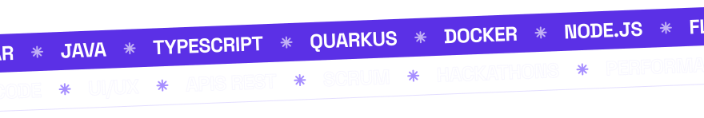</picture>

<picture><source media="(prefers-color-scheme: dark)" srcset="assets/about-dark.svg"><source media="(prefers-color-scheme: light)" srcset="assets/about-light.svg"></picture>

<picture><source media="(prefers-color-scheme: dark)" srcset="assets/learn-dark.svg"><source media="(prefers-color-scheme: light)" srcset="assets/learn-light.svg"></picture>

<picture><source media="(prefers-color-scheme: dark)" srcset="assets/stack-dark.svg"><source media="(prefers-color-scheme: light)" srcset="assets/stack-light.svg"></picture>

<picture><source media="(prefers-color-scheme: dark)" srcset="assets/path-dark.svg"><source media="(prefers-color-scheme: light)" srcset="assets/path-light.svg"></picture>

<a href="https://github.com/BernardoPatriarca?tab=repositories"><picture><source media="(prefers-color-scheme: dark)" srcset="assets/works-dark.svg"><source media="(prefers-color-scheme: light)" srcset="assets/works-light.svg"></picture></a>

<a href="https://github.com/BernardoPatriarca/zela"><picture><source media="(prefers-color-scheme: dark)" srcset="assets/zela-dark.svg"><source media="(prefers-color-scheme: light)" srcset="assets/zela-light.svg"></picture></a>

<a href="https://github.com/BernardoPatriarca/catalogo-filmes-series"><picture><source media="(prefers-color-scheme: dark)" srcset="assets/catalogo-dark.svg"><source media="(prefers-color-scheme: light)" srcset="assets/catalogo-light.svg"></picture></a>

<a href="https://github.com/BernardoPatriarca/multi-plataform"><picture><source media="(prefers-color-scheme: dark)" srcset="assets/multi-dark.svg"><source media="(prefers-color-scheme: light)" srcset="assets/multi-light.svg"></picture></a>

<a href="https://github.com/BernardoPatriarca/prime-crm"><picture><source media="(prefers-color-scheme: dark)" srcset="assets/crm-dark.svg"><source media="(prefers-color-scheme: light)" srcset="assets/crm-light.svg"></picture></a>

<a href="https://github.com/BernardoPatriarca?tab=repositories"><picture><source media="(prefers-color-scheme: dark)" srcset="assets/github-dark.svg"><source media="(prefers-color-scheme: light)" srcset="assets/github-light.svg"></picture></a>

<a href="https://bernardopatriarca.netlify.app/#playground"><picture><source media="(prefers-color-scheme: dark)" srcset="assets/terminal-dark.svg"><source media="(prefers-color-scheme: light)" srcset="assets/terminal-light.svg"></picture></a>

<a href="https://bernardopatriarca.netlify.app/#contact"><picture><source media="(prefers-color-scheme: dark)" srcset="assets/contact-dark.svg"><source media="(prefers-color-scheme: light)" srcset="assets/contact-light.svg"></picture></a>

<a href="https://bernardopatriarca.netlify.app"><picture><source media="(prefers-color-scheme: dark)" srcset="assets/chip-site-dark.svg"><source media="(prefers-color-scheme: light)" srcset="assets/chip-site-light.svg"></picture></a>
<a href="https://www.linkedin.com/in/bernardopatriarca/"><picture><source media="(prefers-color-scheme: dark)" srcset="assets/chip-linkedin-dark.svg"><source media="(prefers-color-scheme: light)" srcset="assets/chip-linkedin-light.svg"></picture></a>

<a href="mailto:bernardopatriarca2026@gmail.com"><picture><source media="(prefers-color-scheme: dark)" srcset="assets/chip-mail-dark.svg"><source media="(prefers-color-scheme: light)" srcset="assets/chip-mail-light.svg"></picture></a>
<a href="https://wa.me/5546999716231"><picture><source media="(prefers-color-scheme: dark)" srcset="assets/chip-whats-dark.svg"><source media="(prefers-color-scheme: light)" srcset="assets/chip-whats-light.svg"></picture></a>

<a href="https://www.instagram.com/bernardopatriarca/"><picture><source media="(prefers-color-scheme: dark)" srcset="assets/chip-insta-dark.svg"><source media="(prefers-color-scheme: light)" srcset="assets/chip-insta-light.svg"></picture></a>
<a href="https://github.com/BernardoPatriarca?tab=repositories"><picture><source media="(prefers-color-scheme: dark)" srcset="assets/chip-repos-dark.svg"><source media="(prefers-color-scheme: light)" srcset="assets/chip-repos-light.svg"></picture></a>

<picture><source media="(prefers-color-scheme: dark)" srcset="assets/footer-dark.svg"><source media="(prefers-color-scheme: light)" srcset="assets/footer-light.svg">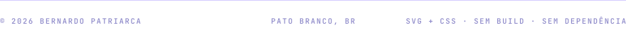</picture>

